<p align="center">
  
</p>

<h3 align="center">A cinema booking app, redesigned around how people actually pick a movie.</h3>

<p align="center">
  Browse what's on, choose a showtime, pick your seats and manage your tickets, in a dark, poster-first interface inspired by Netflix.
</p>

<p align="center">
  
  
  
  
  
</p>

<p align="center">
  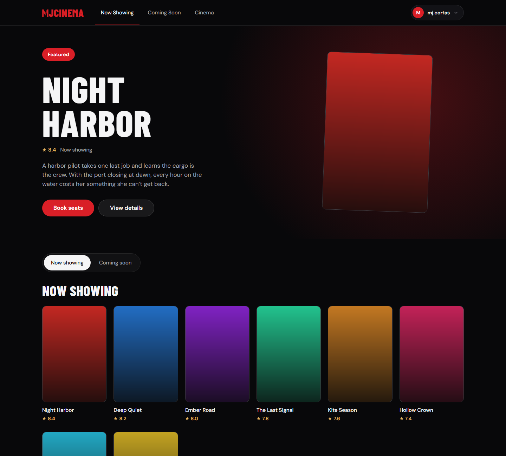
</p>

> Screenshots in this README are generated by Playwright from the real app, with the backend mocked by sample data (`web/e2e/readme-shots.spec.ts`). Poster art is placeholder art; the app itself loads real TMDB posters.

## Why this project

MJCinema started as a working but basic booking site: static HTML, CSS and vanilla JavaScript, built against a Spring Boot REST API. It worked, but it was hard to use and hard to extend: the navigation overflowed on phones, errors were browser `alert()` boxes, and nothing told you what was happening while the free-tier backend woke up.

This repository is the **redesign and migration** of that frontend to React and TypeScript. The brief I set myself was strict: **change how it looks and feels, not what it does.** Every screen, API call, `localStorage` key and redirect had to keep working exactly as before, and I could prove it.

## Designed for a better experience

The look is deliberately close to the way Netflix presents a catalogue: a near-black canvas, one confident red accent, large poster art and a single featured title up front. That layout suits cinema booking because the first question is always "what do I want to watch?", and the answer is visual.

| What changed | Why it helps |
|---|---|
| **Featured hero** on the dashboard | Opens on a movie that is actually bookable soon: the Now Showing title with the earliest upcoming showtime, picked from live schedule data. |
| **Poster-first grid** with Now showing / Coming soon / Cinema views | Browsing is visual and one tap away, instead of a text list. |
| **Showtime picker inside the movie details** | Dates, then cinemas, then times, with one chip per showtime. Nobody has to leave the page to find out when it plays. |
| **Interactive seat map** | A curved screen, aisles, price tiers (VIP, Regular, Balcony) with a generated legend, and a live total and seat list in a sticky bar. |
| **Loading, empty and error states everywhere** | The backend runs on a free tier and can take a minute to wake up. Every data view shows a skeleton, an empty state or an error with Retry, and slow sign-ins explain the wait. |
| **In-page dialogs instead of `alert()` and `confirm()`** | Same messages, but styled, focus-trapped and keyboard friendly. |
| **Mobile layouts** | Full-screen movie sheet, a sticky checkout bar and an admin drawer. The old dashboard nav overflowed at 390px. |
| **Admin console** | A real sidebar layout with sales cards, a weekly sales chart, a movie leaderboard, schedule analytics and add-movie and add-schedule flows, all with toasts. |

<table>
  <tr>
    <td width="50%">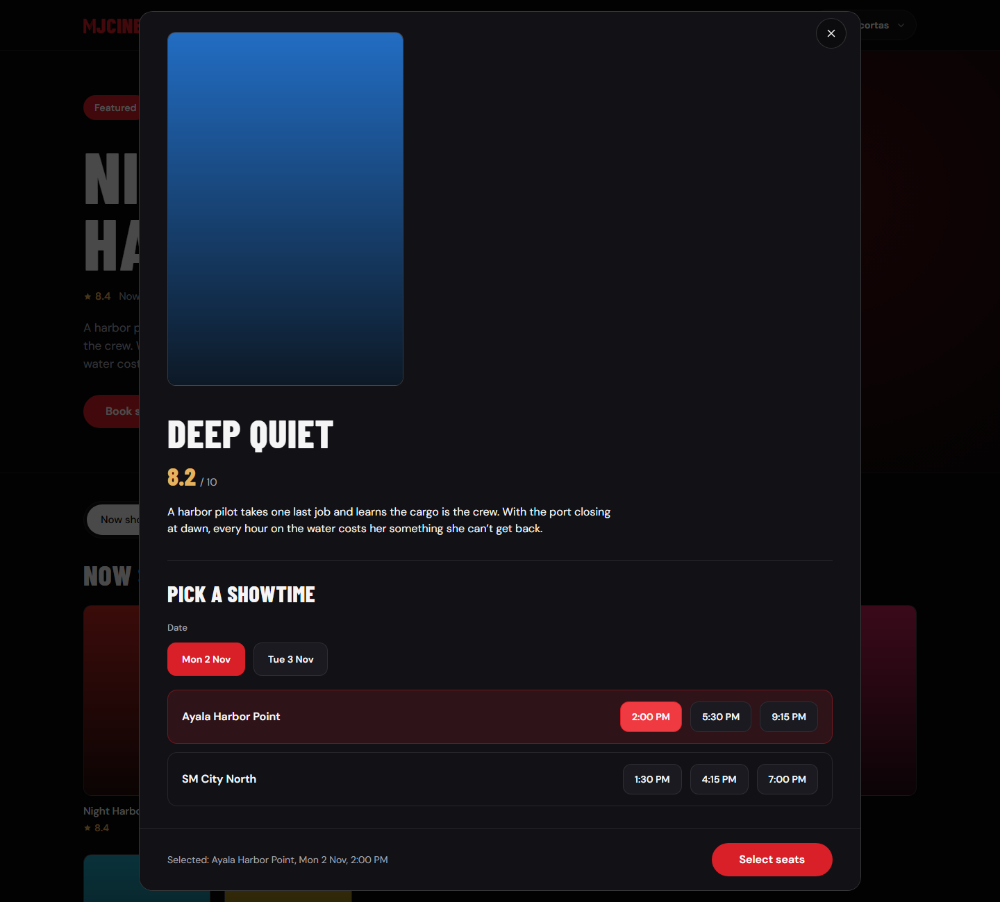</td>
    <td width="50%">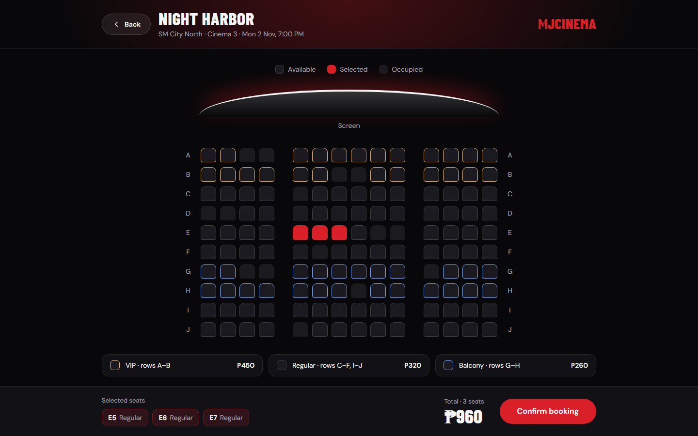</td>
  </tr>
  <tr>
    <td align="center"><sub>Movie details with the inline showtime picker</sub></td>
    <td align="center"><sub>Seat selection with price tiers and a live total</sub></td>
  </tr>
  <tr>
    <td width="50%">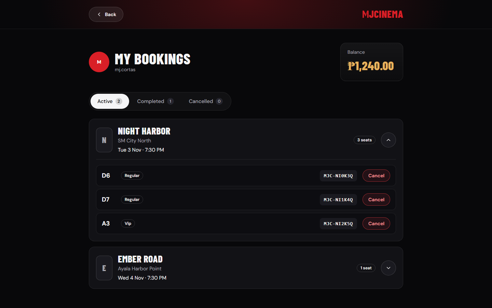</td>
    <td width="50%">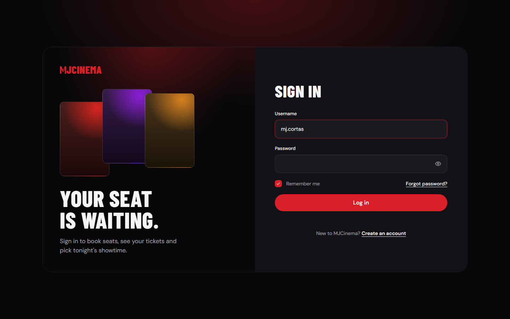</td>
  </tr>
  <tr>
    <td align="center"><sub>My bookings, grouped by showtime, with per-seat cancel</sub></td>
    <td align="center"><sub>Sign in</sub></td>
  </tr>
</table>

### Admin

<table>
  <tr>
    <td width="50%">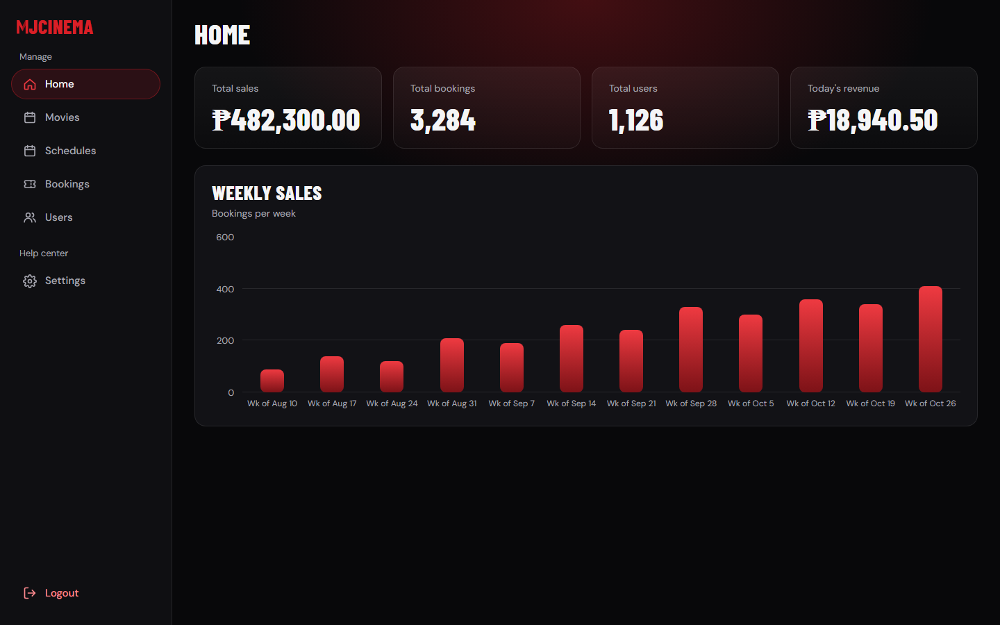</td>
    <td width="50%">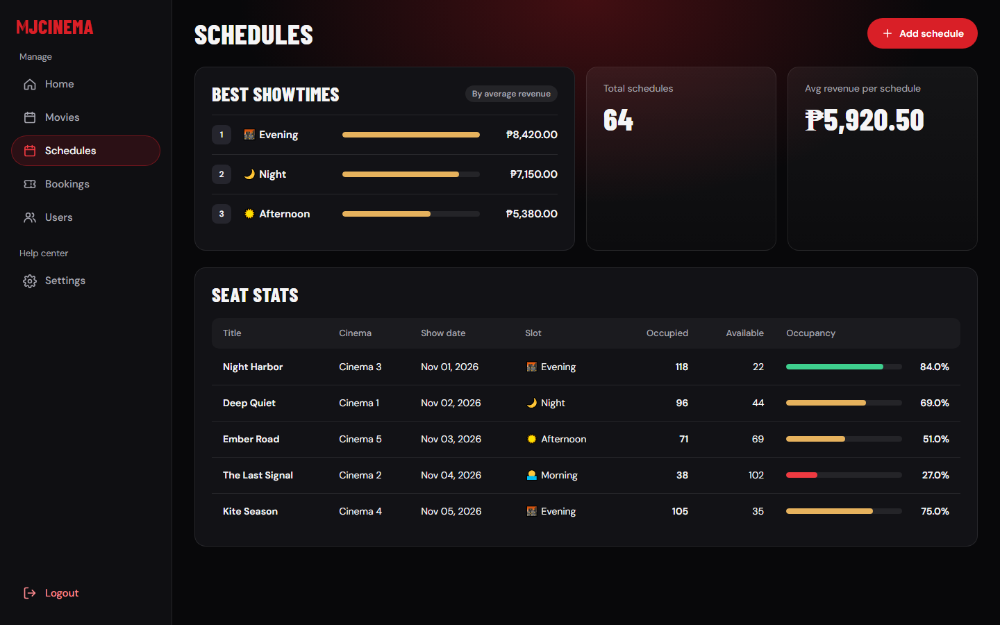</td>
  </tr>
  <tr>
    <td align="center"><sub>Home: totals and a weekly sales chart drawn in plain CSS, no chart library</sub></td>
    <td align="center"><sub>Schedules: best showtimes and seat occupancy</sub></td>
  </tr>
  <tr>
    <td colspan="2">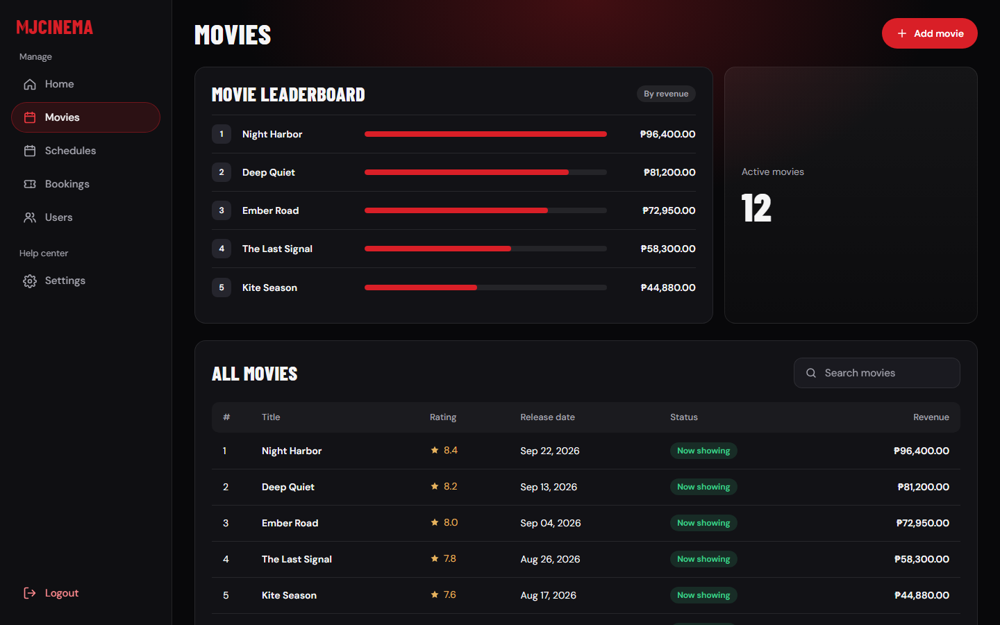</td>
  </tr>
  <tr>
    <td colspan="2" align="center"><sub>Movies: revenue leaderboard, live search and a TMDB-backed "Add movie" flow</sub></td>
  </tr>
</table>

### Mobile

<table>
  <tr>
    <td width="25%">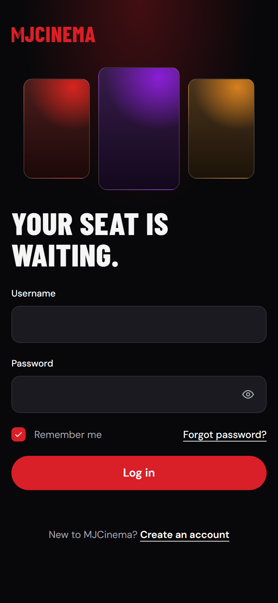</td>
    <td width="25%">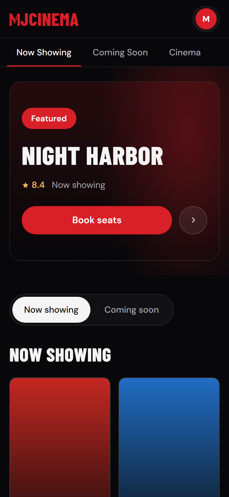</td>
    <td width="25%">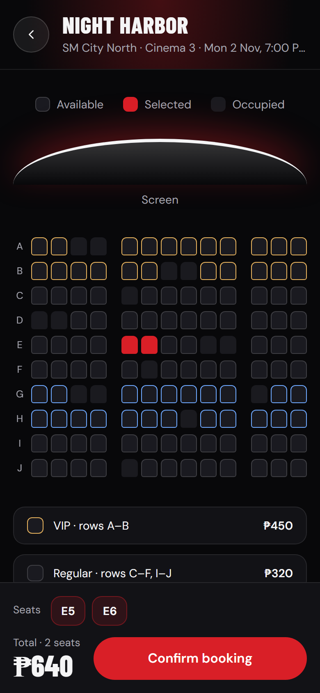</td>
    <td width="25%">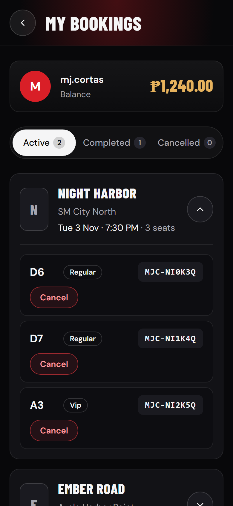</td>
  </tr>
</table>

## Features

**Customers**
- Register and sign in, with validation and clear error feedback.
- Browse Now Showing and Coming Soon movies, or browse by cinema.
- Pick a date, cinema and showtime, then choose seats on a live map with occupied seats locked.
- Confirm the booking and see a clear success or failure result.
- Review bookings by status (Active, Completed, Cancelled) and cancel individual seats.

**Admins**
- Dashboard of total sales, bookings, users and today's revenue, plus a weekly trend.
- Movie leaderboard and a searchable movie table; add movies by searching TMDB.
- Schedule analytics (best showtimes, average revenue, occupancy) and a form to add schedules.

## Engineering

**Stack:** React 19, TypeScript, Vite, Tailwind CSS 4, React Router 7, Playwright. No UI kit and no chart library: the components and the charts are built in-house.

**A contract, not a rewrite.** [`frontend-redesign.md`](frontend-redesign.md) documents every screen, popup, flow, `localStorage` key and backend call of the original app. The migration followed it screen by screen, and the legacy code stays untouched in [`static/`](static) as a reference. When a decision changed behaviour (for example, showing a failure dialog on a network error while booking), it was written down in the same change.

**A parity audit.** I compared every API call (method, URL, params, headers, credentials, body and response parsing) against that contract and fixed what differed. One real bug surfaced: a successful ticket cancellation whose response body was not JSON would have been treated as a failure.

**Design system.** Colour, type, radius and spacing tokens are defined once in [`web/src/index.css`](web/src/index.css) from [`design/design/system/tokens.md`](design/design/system/tokens.md), and screens use only the shared components in [`web/src/components/ui`](web/src/components/ui). Headings use Barlow Condensed and body text uses DM Sans.

**One API layer.** Everything that touches the backend lives in [`web/src/api`](web/src/api), with typed responses. Pages never call `fetch` directly.

**Accessibility.** Dialogs trap focus and restore it on close, controls have labels and roles, state changes are announced through live regions, and reduced-motion is respected.

**Tests.** Playwright end-to-end tests run against a mocked backend and assert the exact requests the app makes (method, URL, headers, body), plus loading, empty and error states, at desktop (1440) and mobile (390) widths.

```
web/
├─ src/
│  ├─ api/            typed backend client (the only place that calls fetch)
│  ├─ components/ui/  shared design-system components
│  ├─ features/       dashboard, booking, tickets and admin building blocks
│  ├─ pages/          one component per route
│  ├─ lib/ store/     formatting, pricing rules, shared state
│  └─ index.css       theme tokens
└─ e2e/               Playwright specs
```

## Run it locally

You need Node 20.19 or newer (a Vite requirement). The backend is a separate Spring Boot service (hosted on Render) and is not part of this repository.

```bash
cd web
npm install
npm run dev -- --host 127.0.0.1 --port 5500 --strictPort
```

Then open <http://127.0.0.1:5500>. The backend only allows that origin through CORS, which is why the dev server is pinned to it. To point at another backend, set `VITE_API_URL` (see `web/.env.example`).

| Command | What it does |
|---|---|
| `npm run build` | Type-check and produce a production build |
| `npm run lint` | Lint with Oxlint |
| `npm run e2e` | Run the Playwright suite |
| `npx playwright test readme-shots` | Regenerate the images in this README |

Some tests run against the real backend and need test accounts in `web/.env.local`; without them those tests are skipped.

## Routes

`/` sign in, `/register`, `/dashboard`, `/bookseat`, `/tickets`, and the admin console at `/admin`, `/admin/movies`, `/admin/schedules`, `/admin/bookings`, `/admin/users`.

## Known limits and next steps

- **Admin Bookings and Users** are "coming soon" pages. The designs exist, but the backend has no endpoints that list all bookings or all users yet.
- **No route guards**, matching the original app: pages open without signing in. Adding guards is a deliberate second step.
- **Design details with no data source** (genre, duration, cast, trailers) are left out rather than invented.
- **Cinema cards** do not show a movie count, because the list endpoint does not return one. Two options are noted in [`CLAUDE.md`](CLAUDE.md).

## Author

Built by [@Jenel-web](https://github.com/Jenel-web).
